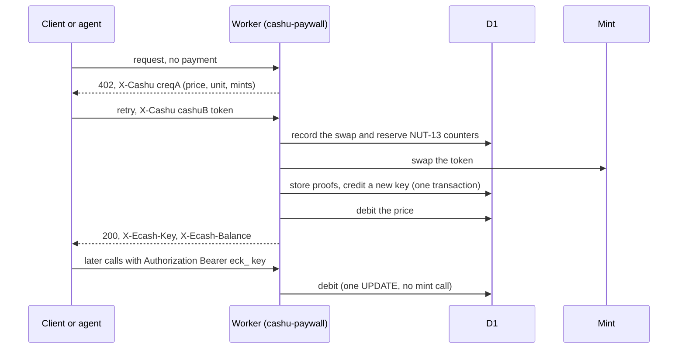

# cashu-paywall

[](https://github.com/Spider333/cashu-paywall/actions/workflows/ci.yml)
[](LICENSE)

Charge per call in [Cashu](https://cashu.space) ecash, on Cloudflare Workers and MCP servers.

- **NUT-24 HTTP 402.** Wrap a route with `paywall.protect()`. An unpaid request gets `402 Payment Required` with `X-Cashu: creqA…`, and a retry that carries `X-Cashu: cashuB…` is served.
- **Prepaid keys.** A payment becomes credit on a bearer key `eck_…`. Each paid call takes credit off the key in one D1 statement, without calling the mint.
- **MCP.** `cashu-paywall/mcp` prices your tools and adds `ecash_topup`, `ecash_balance` and `ecash_refund`, so an agent can pay with no account.
- **Lightning and refunds.** A top-up page at `/ecash` (Lightning invoice or pasted token), refunds as a fresh token, and an optional daily melt of earnings to your Lightning address.

**Why.** NUT-24 defines HTTP 402 for Cashu, but the NUTs README lists no wallet and no mint that implements it (checked 6 Nov 2026), and we know of no other server library for it. MCP servers had no way to take ecash either. This is a server-side NUT-24 implementation, with an MCP adapter on top.

> **Status: 0.1.0, unreleased, unaudited.** Tested only against `testnut.cashu.space`, a test mint whose Lightning is fake. Use a test mint first. Read [docs/security.md](docs/security.md) before you point it at a mint with real sats.

## Try it in 5 minutes

You need Node 22.4+ and nothing else: no Cloudflare account, no wallet, no real sats. The demo Worker sells "nut facts" for 5 test sats each.

```sh
git clone https://github.com/Spider333/cashu-paywall.git && cd cashu-paywall
npm install && npm run build
cd examples/demo-worker
npm run dev-vars                      # fresh local secrets in .dev.vars (gitignored)
npm run db:local                      # create the local D1 tables
npm run dev                           # leave running: http://localhost:8787
```

In a second terminal, from the repo root. First, no payment:

```
$ curl -si "localhost:8787/api/nut-fact?nut=24"
HTTP/1.1 402 Payment Required
Content-Length: 373
Content-Type: application/json; charset=utf-8
Cache-Control: no-store
X-Cashu: creqApmFpaGFjYmY1Yzg3YWEFYXVjc2F0YW2BeBtodHRwczovL3Rlc3RudXQuY2FzaHUuc3BhY2VhZHdPbmUgQ2FzaHUgTlVULCBvbmUgbGluZWFz9Q==

{"error":"Payment required: pay with a Cashu token in the X-Cashu header.","code":"ECASH_PAYMENT_REQUIRED","retryable":false,"price_sats":5,"unit":"sat","mints":["https://testnut.cashu.space"],"payment_request":"creqApmFpaGFjYmY1Yzg3YWEFYXVjc2F0YW2BeBtodHRwczovL3Rlc3RudXQuY2FzaHUuc3BhY2VhZHdPbmUgQ2FzaHUgTlVULCBvbmUgbGluZWFz9Q==","topup_url":"http://localhost:8787/ecash"}
```

Get a 20-sat test token from testnut and pay with it:

```
$ TOKEN=$(npm run -s demo:token -- 20)
$ curl -si -H "X-Cashu: $TOKEN" "localhost:8787/api/nut-fact?nut=24"
HTTP/1.1 200 OK
Content-Length: 103
Content-Type: application/json
Cache-Control: no-store
X-Ecash-Balance: 14
X-Ecash-Key: eck_A2_uML0N0eHoY4ffPuZfhtRcST6ExilR_ng5nTAZS8c
X-Ecash-Kid: c56bd006ae18705a

{"nut":24,"title":"HTTP 402 Payment Required","url":"https://github.com/cashubtc/nuts/blob/main/24.md"}
```

20 sats in, 1 sat swap fee to the mint, 5 sats for the call: 14 sats stay on the new key. Spend them with the key, and see the token can't be used twice:

```
$ KEY=eck_A2_uML0N0eHoY4ffPuZfhtRcST6ExilR_ng5nTAZS8c
$ curl -s -H "Authorization: Bearer $KEY" localhost:8787/ecash/balance
{"kid":"c56bd006ae18705a","balance_sats":14,"price_sats_per_call":5,"calls_left":2,"mint":"https://testnut.cashu.space",…}

$ curl -si -H "X-Cashu: $TOKEN" "localhost:8787/api/nut-fact?nut=24"
HTTP/1.1 400 Bad Request
{"error":"This token was already spent.","code":"ECASH_TOKEN_SPENT","retryable":false}
```

The same key works over MCP. [examples/demo-worker](examples/demo-worker) continues with the MCP tools, a refund and the cron. `npm run demo:check` runs the whole script as 14 checks.

## How it works



1. An unpaid request gets a 402 with a NUT-18 payment request (`creqA`, or NUT-26 `creqB` by config) for the price, from the accepted mints.
2. The client retries with a Cashu token. The token is checked without network first: mint on the allowlist, unit `sat`, not locked, within the caps.
3. Before calling the mint, the Worker writes the operation to D1 with a `UNIQUE` claim on the token's inputs and a reserved range of NUT-13 counters.
4. It swaps the token at the mint. The new proofs come from the wallet seed at those counters, so they can be rebuilt (NUT-09) after any crash.
5. One D1 transaction stores the proofs (sealed with AES-GCM), credits the key and marks the operation done. The price is debited and the handler runs.
6. Later calls send the key. Each is one conditional `UPDATE`. A cron settles anything left pending after 15 minutes, and a daily cron can melt surplus sats to your Lightning address.

Details, with diagrams for every flow and the invariants: [docs/how-it-works.md](docs/how-it-works.md).

## API at a glance

### Workers HTTP

```ts
import { createPaywall } from "cashu-paywall";

const paywall = createPaywall({
  db: env.ECASH_DB,                     // D1 with migrations/0001_init.sql
  keyPepper: env.ECASH_KEY_PEPPER,      // secrets
  proofKey: env.ECASH_PROOF_KEY,
  walletSeed: env.ECASH_WALLET_SEED,
  mints: ["https://testnut.cashu.space"],
  publicBaseUrl: "https://my-worker.example.workers.dev",
});

const routed = await paywall.handleRoutes(request); // /ecash page, topup, lightning, balance, refund, keys, info
if (routed) return routed;
return paywall.protect(handler, { priceSats: 5 })(request); // NUT-24 402 around any handler
```

Also: `paywall.debit(key, sats)`, `credit`, `balance`, `topupWithToken`, `startLightningTopup`, `refund`, `paymentRequest`, and `scheduled(controller)` for the crons (`*/10 * * * *` recovery, `0 3 * * *` melt and cleanup).

### MCP

```ts
import { registerEcashTools, withEcashCharge } from "cashu-paywall/mcp";

server.registerTool("lookup", { description: "…", inputSchema: { q: z.string() } },
  withEcashCharge(paywall, { getKey, priceSats: 10 }, async ({ q }: { q: string }) => ({
    content: [{ type: "text", text: await lookup(q) }],
  })));
registerEcashTools(server, paywall, { getKey, priceSats: 10 }); // ecash_topup, ecash_balance, ecash_refund: free
```

A paid tool on an empty key returns `isError: true` with `code: "ECASH_INSUFFICIENT_BALANCE"`, a `payment_request` and a `topup_url`, so an agent knows how to pay.

Step-by-step setup, the MCP transport and every config option: [docs/integration.md](docs/integration.md).

## Security in brief

- Only an HMAC of each key is stored. Proofs are sealed with AES-GCM. A D1 leak alone gives away neither keys nor spendable ecash.
- Every mint call is recorded before it is made, outputs are deterministic (NUT-13), and a recovery job settles anything left pending with checkstate (NUT-07) and restore (NUT-09). Credit lands at most once.
- A token's inputs are claimed with a `UNIQUE` constraint, so one token reaches the mint at most once from here.
- Logs never contain tokens, keys, payment requests, invoices or secrets. A live test runs every money path and checks this.
- Caps on each key and on the total held (custody cap). Melting is off until you set a Lightning address.
- The pot is a claim on a third-party mint: if the mint fails, it is lost. Keep it small.

Threat model, limits and what is not protected: [docs/security.md](docs/security.md). To report a problem: [SECURITY.md](SECURITY.md).

## Limitations and status

- 0.1.0, unreleased, unaudited. Tested against testnut only (cdk-mintd 0.18.1). Not yet published to npm and not yet deployed anywhere.
- Top-ups, refunds and melts need Workers Paid: a swap takes far more than the Free plan's 10 ms of CPU ([docs/performance.md](docs/performance.md)). Paid calls fit either plan.
- `sat` only. One mint per key. Rate limiting needs a Cloudflare Rate Limiting binding.
- The excess of an overpaid NUT-24 request stays as credit on a new key (`X-Ecash-Key`). NUT-24 doesn't define change, so plain NUT-24 clients ignore it ([docs/nut-24.md](docs/nut-24.md)).

## Docs

- [How it works](docs/how-it-works.md): tables, invariants, a sequence diagram for every flow
- [Integration](docs/integration.md): a Worker and an MCP server step by step, the full config table
- [Security model](docs/security.md)
- [NUT-24 notes](docs/nut-24.md): status codes, headers, creqA vs creqB, interop, open spec questions
- [Performance](docs/performance.md): CPU per swap and bundle size
- [Demo Worker](examples/demo-worker)
- [Contributing](CONTRIBUTING.md) · [Changelog](CHANGELOG.md)

## License

MIT. Built with AI assistance (Claude Code). The author directed the work and owns it.
