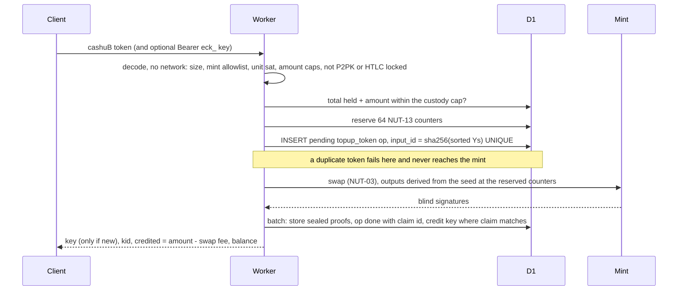
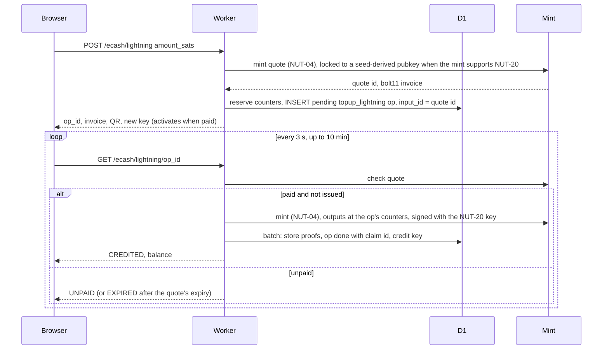
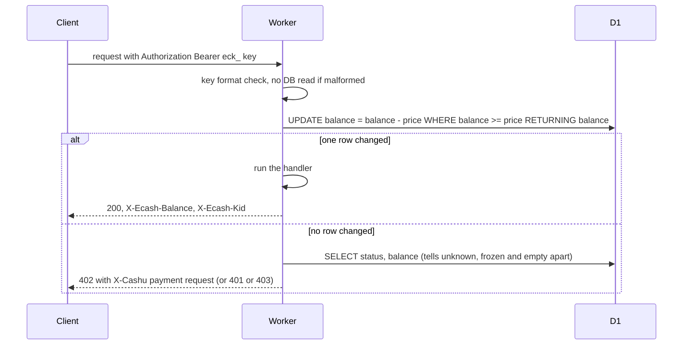
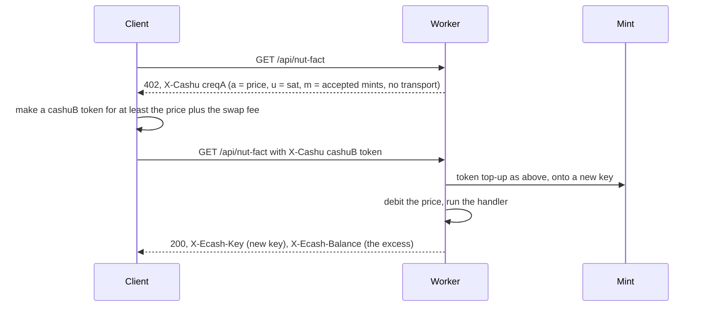
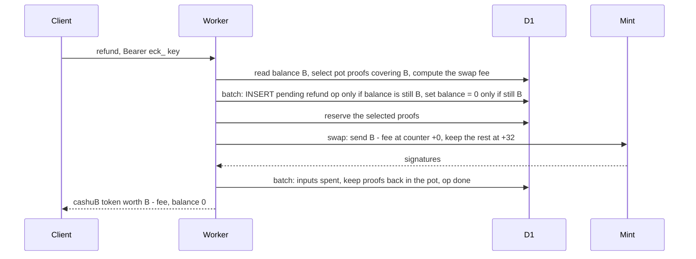
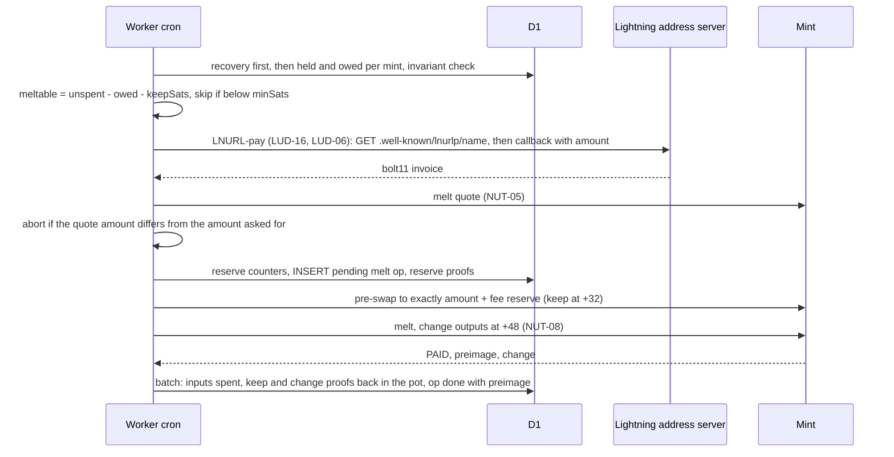
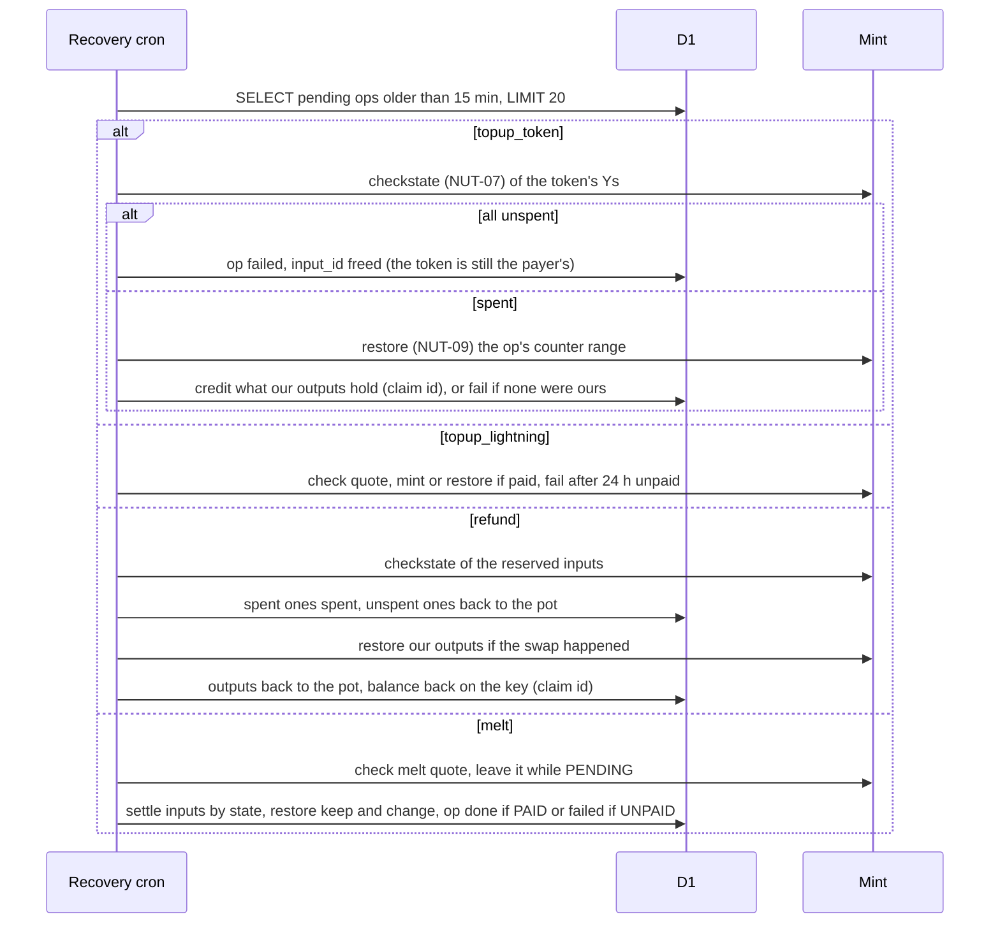

# How it works

cashu-paywall turns Cashu ecash into prepaid credit held in a Cloudflare D1 database. Money moves at the mint only when credit comes in (a top-up) or goes out (a refund or the daily melt). A paid call is one SQL `UPDATE` and never talks to the mint.

This page covers the D1 tables, the rules that keep the money consistent, and each flow as a sequence diagram.

## The D1 tables

The schema is [`migrations/0001_init.sql`](../migrations/0001_init.sql). The database holds nothing else.

| Table | One row per | Notes |
|---|---|---|
| `ecash_keys` | prepaid key | `key_hash` = hex HMAC-SHA256(`keyPepper`, key). The key itself is never stored. `kid` is the first 16 hex characters of the hash and is the only identifier that appears in logs. `balance` has `CHECK (balance >= 0)`. `mint_url` binds the key to one mint at its first credit. |
| `ecash_proofs` | proof the Worker holds (the pot) | `y` = hash_to_curve(secret), the public id the mint uses for checkstate. The proof itself is in `sealed`: AES-256-GCM under `proofKey`, with `y` as associated data. `state` is `unspent`, `reserved` (held by an op) or `spent`. |
| `ecash_ops` | operation that talks to a mint | `kind` is `topup_token`, `topup_lightning`, `refund` or `melt`. `status` is `pending`, `done` or `failed`. `input_id` is `UNIQUE`. `counter_start` and `counter_count` are the NUT-13 range reserved for the op's outputs. |
| `ecash_counters` | keyset | the next free NUT-13 counter. Reserving a range is one atomic `INSERT … ON CONFLICT DO UPDATE … RETURNING`. |
| `ecash_mint_cache` | mint | mint info and keysets, cached for one hour so a request rarely needs a mint round trip. |

## Invariants

These are the rules the code relies on. Each one is enforced by a single statement or a single D1 batch (D1 runs a batch as one transaction).

1. **A balance never goes negative.** The debit is `UPDATE … SET balance = balance - ?1 WHERE key_hash = ?3 AND status = 'active' AND balance >= ?1 RETURNING balance`. Success means `meta.changes = 1`. The column also has `CHECK (balance >= 0)`. 50 parallel debits on a 100-sat key at 10 sats each give exactly 10 successes (test T-DEB-1, run 20 times).
2. **Write before call.** Every operation that makes the mint sign outputs is written to `ecash_ops`, with a reserved NUT-13 counter range, before the mint is called. If the Worker dies at any point, the op row says what was attempted and which outputs to look for.
3. **One token reaches the mint once from here.** A token top-up's `input_id` is the SHA-256 of its sorted proof `Y`s, and `input_id` is `UNIQUE`. A second submission of the same token, in parallel or later, fails on the insert and never reaches the mint.
4. **Credit lands at most once.** The batch that finishes a money-in op flips the op from `pending` to `done` and writes a random claim id in the same statement. The key is credited only `WHERE EXISTS` an op with that claim id. If a status poll and the recovery job race, only one flip succeeds, so only one credit runs. Refund give-backs use the same pattern.
5. **Proofs are reserved before they are spent.** Refunds and melts reserve proofs with `UPDATE … SET state = 'reserved', op_id = ? WHERE state = 'unspent' AND y IN (…)` and go ahead only if every row changed.
6. **NUT-13 counters only move forward.** Each op takes a fresh block of 64 counters. If the mint says an output was already signed (the counter went backwards, for example after a D1 restore from backup), the library jumps the counter ahead by a random 2^20 to 2^20 + 2^27 and retries, at most twice. Nothing is spent when that happens.
7. **Held ≥ owed, per mint.** Every cron run checks that the sum of unspent and reserved proofs for each mint is at least the sum of the balances of keys bound to it. If not, it logs `ecash_invariant_broken` at error level, sets `invariantOk: false` and skips all melts.

### The counter block

Each op reserves 64 counters. The wallet uses minimal splits (`denominationTarget: 1`), so an amount below 2^16 sats needs at most 16 outputs, and every output of an op lands inside its block:

| Offset | Outputs |
|---|---|
| +0 | a received token, minted Lightning proofs, or the token sent in a refund |
| +32 | proofs kept after a refund or a melt pre-swap |
| +48 | melt change (NUT-08) |

A NUT-09 restore of the op's block therefore finds everything the mint signed for it.

## Token top-up

`topupWithToken`, `POST /ecash/topup`, an `X-Cashu` header on a protected route, or the MCP tool `ecash_topup`.

If the mint says the token is spent (NUT error 11001), the op is marked `failed` and the client gets `ECASH_TOKEN_SPENT`. If the mint can't be reached or times out, the outcome is unknown: the op stays `pending`, the client gets `503 ECASH_PENDING`, and the recovery job settles it. A key created by that request is returned in the error body and in `X-Ecash-Key`, because it is shown nowhere else.

## Lightning top-up

`POST /ecash/lightning`, then `GET /ecash/lightning/:op_id`. The page at `GET /ecash` drives both.

The quote id never reaches the browser: the browser only sees the random op id. The op is written right after the quote is created rather than before, because the quote id only exists once the mint returns it, and a quote moves no money. If a poll finds the quote already issued (a crash after minting, or two polls racing), it restores the outputs from the op's counter range (NUT-09) instead of minting again.

## A paid call

`protect()` on an HTTP route with `Authorization: Bearer eck_…`, or `withEcashCharge()` around an MCP tool.

If the handler throws, the debit is credited back and the client gets a 500. An MCP tool wrapped with `withEcashCharge` credits the debit back only for errors matched by its `refundOn` option.

## The NUT-24 402 retry

The token must cover the price after the mint's swap fee, because NUT-18 defines the requested amount as net of input fees. Any excess stays on the new key, which the client can use as a bearer key for later calls. [nut-24.md](nut-24.md) has the details and the open spec questions.

## Refund

`refund`, `POST /ecash/refund`, or the MCP tool `ecash_refund`.

Zeroing the balance and inserting the op happen in one batch, both conditioned on the balance still being `B`, so a debit racing in makes both do nothing and the refund retries. If the mint refuses the swap, nothing moved: the proofs are released and the balance comes back at once. If the outcome is unknown, the op stays `pending` and the recovery job gives the balance back (the client never received a token, so they can refund again).

## Daily melt

Cron `0 3 * * *` (UTC). Off unless `melt.lightningAddress` is set.

The melt moves only the surplus: sats held beyond what keys are owed, minus a reserve (`keepSats`, default 500). The pre-swap means the mint never receives more than amount + fee reserve, and anything it doesn't use comes back as NUT-08 change at known counters. The same cron run then deletes keys that were never funded and are older than 7 days.

## Crash recovery

Cron `*/10 * * * *`, and first in the daily run. It picks up to 20 ops that have been `pending` for more than 15 minutes, oldest first. An op that can't be settled yet moves to the back of the queue.

Two recovery runs can overlap (the daily and the 10-minute cron both fire at 03:00). Every settlement is a conditional `pending → done/failed` flip with a claim id, and storing restored proofs ignores duplicates, so running twice changes nothing.

Everything above depends on the wallet seed. With `walletSeed` and the counters in `ecash_ops`, any output the mint signed can be rebuilt. Losing both the seed and the database loses the pot.
